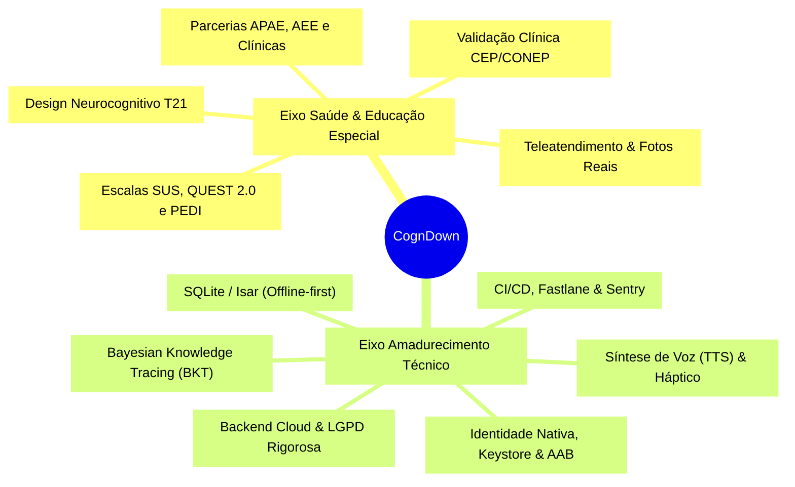
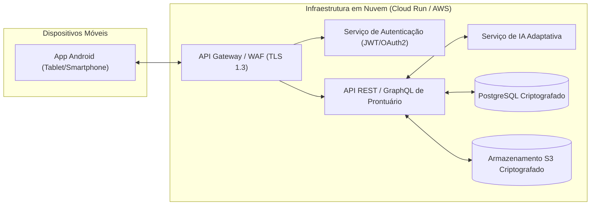

# Roteiro de Evolução Estratégica: Saúde PcD & Amadurecimento Tecnológico

**Projeto:** CognDown — Software Adaptativo e Gamificado para Estímulo Cognitivo e Comunicação  
**Autor:** Pedro Garibaldi Santos  
**Instituição:** FATEC Ribeirão Preto — Curso Superior de Tecnologia em Análise e Desenvolvimento de Sistemas  
**Disciplina:** Programação para Dispositivos Móveis (Prof. Dr. Rodrigo de Oliveira Plotze)  
**Tema Base:** *"Desenvolvimento e Avaliação de um Software Adaptativo e Gamificado para o Estímulo de Habilidades Cognitivas e de Comunicação em Indivíduos com Síndrome de Down"*

---

## Sumário Executivo

Este documento consolida o planejamento de médio e longo prazo para que o **CognDown** transcenda a entrega acadêmica da disciplina e se consolide como uma tecnologia assistiva de **alto impacto social, clínico e educacional**, com sustentabilidade técnica e solidez arquitetural.

O roteiro divide-se em dois grandes eixos estratégicos:
1. **Eixo 1 — Foco na Área da Saúde e Educação Especial de PcDs (Síndrome de Down / T21)**;
2. **Eixo 2 — Amadurecimento Técnico da Solução (Engenharia de Software, Infraestrutura em Nuvem e Android Nativo)**.



---

# EIXO 1: Foco na Área da Saúde e Educação Especial de PcDs

### 1.1 Fundamentação no Perfil Neurocognitivo da Síndrome de Down (T21)
O desenvolvimento e evolução contínua das interfaces e dinâmicas do CognDown devem seguir rigorosamente as características neurocognitivas da Trissomia 21:
* **Predominância Visuoespacial:** Pessoas com T21 processam e retêm melhor a informação visual concreta em comparação com instruções auditivo-verbais puras. Portanto, qualquer nova funcionalidade deve priorizar ícones de alto contraste, pistas contextuais e diagramação limpa.
* **Apoio à Memória de Trabalho Fonológica:** Instruções faladas devem ser curtas, diretas e acompanhadas de pistas gráficas correspondentes.
* **Aprendizagem sem Erro (*Errorless Learning*):** Em vez de punições (como perda de vidas ou redução de pontos), o aplicativo deve fornecer andaimes visuais (*scaffolding*) imediatos após uma hesitação ou escolha incorreta, preservando a motivação e prevenindo a esquiva comportamental.
* **Tempo de Latência Estendido:** A interface não deve impor cronômetros de contagem regressiva punitivos ou transições automáticas que acelerem a resposta motora do assistido.

### 1.2 Protocolo de Validação Clínica e Rigor Metodológico
Para que a ferramenta seja reconhecida pela comunidade científica e fonoaudiológica, é fundamental conduzir pesquisas empíricas aplicadas:
1. **Submissão ao Comitê de Ética em Pesquisa (CEP/CONEP):**
   * Registro formal de projeto de intervenção clínica longitudinal envolvendo participantes com T21, mediadores e profissionais.
   * Aplicação de Termo de Consentimento Livre e Esclarecido (TCLE) aos responsáveis legais e Termo de Assentimento Livre e Esclarecido (TALE) adaptado em linguagem simples/visual para os participantes.
2. **Aplicação de Instrumentos Padronizados de Medição:**
   * **System Usability Scale (SUS):** Mensuração contínua da usabilidade percebida (já integrada ao aplicativo, convertida para escore 0–100).
   * **QUEST 2.0 (*Quebec User Evaluation of Satisfaction with Assistive Technology*):** Avaliação formal da satisfação do usuário e da equipe terapêutica com os dispositivos de tecnologia assistiva.
   * **PEDI (*Pediatric Evaluation of Disability Inventory*):** Verificação longitudinal de ganhos reais de funcionalidade e autonomia nas atividades de vida diária (AVDs).
   * **Inventários de Comunicação Funcional (ex.: ABLLS-R e VB-MAPP):** Acompanhamento da ampliação do repertório de mandos (pedidos de necessidades) e tatos (nomeação de objetos e sentimentos).

### 1.3 Personalização Contextual de Alta Resolução (Fotos da Vida Real)
* **Demanda Clínica:** Na intervenção com Comunicação Aumentativa e Alternativa (CAA), símbolos genéricos (como um desenho abstrato de um copo de água ou uma cadeira) podem ser difíceis de generalizar para crianças em estágios iniciais de abstração.
* **Próximo Passo:** Implementar funcionalidade no painel terapêutico que permita à família ou terapeuta fotografar o copo favorito da criança, seu prato habitual, sua mãe, pai, terapeuta e animal de estimação, gerando cartões pictográficos personalizados no tablet com fotos reais do seu ambiente afetivo e domiciliar.

### 1.4 Tele-reabilitação e Integração da Tríade Terapêutica
* **Conexão Especialista — Família — Educando:**
  * **Especialista (Fonoaudiólogo/TO/Psicopedagogo):** Configura objetivos terapêuticos semanais, libera novos desafios cognitivos e monitora a evolução pelo prontuário digital.
  * **Mediador Familiar:** Recebe orientações didáticas sobre como mediar o uso do aplicativo em casa, evitando a entrega passiva de telas e estimulando o diálogo funcional.
  * **Educando:** Interage em um ambiente gamificado, consistente e previsível tanto na clínica quanto em casa e na escola.

### 1.5 Parcerias Institucionais Estratégicas
* Articulação de acordos de cooperação técnica com:
  * Unidades da **APAE (Associação de Pais e Amigos dos Excepcionais)** de Ribeirão Preto e região;
  * Salas de Recursos Multifuncionais do **Atendimento Educacional Especializado (AEE)** da Secretaria Municipal de Educação;
  * Clínicas-escola de Fonoaudiologia, Terapia Ocupacional e Psicologia de universidades da região.

---

# EIXO 2: Amadurecimento Técnico da Solução

### 2.1 Preparação para Aplicativo Nativo Android de Produção
Para que o protótipo se torne um instalador oficial para a Google Play Store:
1. **Identidade e Domínio de Pacote:**
   * Substituir o identificador genérico em `android/app/build.gradle.kts`:
     ```kotlin
     // De: applicationId = "com.example.app_projeto"
     // Para:
     applicationId = "br.gov.sp.fatec.cogndown"
     namespace = "br.gov.sp.fatec.cogndown"
     ```
2. **Ícones de Lançamento (*Adaptive Launcher Icons*):**
   * Configuração de ícones vetoriais com suporte a ícones adaptativos do Android 8.0+ e ícones monocromáticos do Android 13+ (*themed icons*) via pacote `flutter_launcher_icons`.
3. **Splash Screen Nativa de Alta Performance:**
   * Utilizar `flutter_native_splash` para que a inicialização no Android exiba o logotipo e cores da identidade visual antes do carregamento da engine Flutter, eliminando a tela branca/preta inicial.
4. **Assinatura Criptográfica de Lançamento (*Release Keystore*):**
   * Geração da chave criptográfica privada (`cogndown-release.jks`) e configuração protegida via `android/key.properties` (adicionado ao `.gitignore`).
   * Configuração de compilação em **Android App Bundle (AAB)** otimizado com ofuscação R8/ProGuard (`flutter build appbundle --release`).

### 2.2 Persistência Local e Arquitetura *Offline-First* (Foco na Parte 2)
* **Situação Atual (Parte 1):** Gerenciamento em memória via `ChangeNotifier` e `GetIt`.
* **Próxima Etapa (Parte 2):**
  * Integração de banco de dados relacional embutido com **SQLite** (`sqflite` / `drift`) ou banco NoSQL tipado de alta velocidade (**Isar Database**);
  * Armazenamento permanente de usuários cadastrados, histórico de avaliações SUS, registros de sessões e medalhas conquistadas;
  * **Operação 100% Offline-First:** O aplicativo deve funcionar perfeitamente em consultórios, escolas rurais ou residências sem acesso à internet, sincronizando os dados em segundo plano quando a conectividade for restabelecida.

### 2.3 Recursos Multimodais e de Acessibilidade Sensorial
1. **Síntese Vocal Nativa (Text-to-Speech — TTS):**
   * Integração do pacote `flutter_tts` com suporte à voz em Português do Brasil (pt-BR).
   * Ao tocar no botão **"Expressar Frase"** na Prancha CAA, o dispositivo sintetizará a fala em voz alta (ex.: *"Eu quero beber água, obrigado"*), transformando o tablet em uma verdadeira prótese vocal comunicativa para o assistido.
2. **Feedback Auditivo Suave e Resposta Háptica:**
   * Efeitos sonoros discretos e harmoniosos para reforço de acertos e celebração de medalhas;
   * Resposta vibratória tátil suave (`HapticFeedback.selectionClick()`) ao selecionar cartões pictográficos, proporcionando confirmação cinestésica aos indivíduos com hipossensibilidade sensorial.
3. **Design Responsivo para Tablets em Modo Paisagem (*Landscape*):**
   * Tablets de 10" e 11" apoiados em suportes inclinados são o padrão ouro em sessões fonoaudiológicas.
   * Criação de layouts específicos de tela dividida (*Master-Detail* / *Dual Pane*) para telas grandes.

### 2.4 Infraestrutura em Nuvem, Microsserviços e Segurança (LGPD / HIPAA)


1. **Conformidade Rigorosa com a LGPD (Lei Geral de Proteção de Dados):**
   * Dados clínicos e pedagógicos de crianças e pessoas com deficiência intelectual são categorizados como **dados sensíveis**.
   * Criptografia em trânsito (TLS 1.3) e em repouso (AES-256 no banco de dados e nos tokens locais via `flutter_secure_storage`);
   * Anonimização dos registros para fins de relatórios acadêmicos e dashboards de pesquisa estatística;
   * Segregação estrita por instituição (*multi-tenancy*), garantindo que dados de uma clínica ou escola jamais sejam visíveis por outra.
2. **Backend Escalável e Econômico:**
   * Microsserviços ou arquitetura limpa em Go ou Node.js (NestJS) hospedados em contêineres gerenciados com escalabilidade sob demanda (Google Cloud Run ou AWS ECS Fargate).

### 2.5 Evolução do Motor Adaptativo com Inteligência Artificial
* **Do Heurístico Determinístico para Modelos Probabilísticos:**
  * O motor atual (regras de 2 acertos para promoção e 2 erros para suporte) é eficiente e transparente.
  * O próximo nível incorporará o **Bayesian Knowledge Tracing (BKT)** e a **Teoria de Resposta ao Item (TRI)**: algoritmos consagrados que estimam continuamente a probabilidade latente de que o assistido realmente compreendeu o conceito por trás do exercício (diferenciando um chute aleatório de uma resposta segura).
* **Detecção Inteligente de Sobrecarga e Fadiga Cognitiva:**
  * Análise passiva da dispersão temporal de toques e aumento da latência motora para identificar o momento exato em que o educando começa a se cansar, emitindo uma sugestão proativa ao mediador de encerrar a sessão com um reforço positivo.

### 2.6 Engenharia Contínua, DevOps e Distribuição
1. **Esteira de Integração e Entrega Contínua (CI/CD):**
   * Configuração de pipeline no GitHub Actions para execução automática de `flutter analyze`, `flutter test` e testes de interface ponta a ponta a cada commit.
2. **Distribuição Automatizada via Fastlane:**
   * Envio automático de novas versões para faixas de teste fechado (*Closed Testing Track*) na Google Play Store, permitindo que a equipe de fonoaudiologia receba atualizações semanais de teste diretamente no tablet.
3. **Observabilidade e Gestão de Incidentes:**
   * Integração de ferramentas de telemetria sem dados pessoais identificáveis (Crashlytics ou Sentry) para monitoramento em tempo real de estabilidade (garantindo índice de 99,9% *crash-free sessions*).

---

## Matriz de Priorização Estratégica (Roadmap)

| Marco Temporal | Eixo Saúde PcD | Eixo Técnico & Infra | Meta de Entrega |
| :--- | :--- | :--- | :--- |
| **Curto Prazo (Conclusão Parte 1 & Transição Parte 2)** | Feedback de profissionais sobre pranchas; roteiro terapêutico em uso piloto. | Testes automatizados 100% (`Etapa 6`); síntese de voz (TTS) na Prancha CAA; persistência local em SQLite. | Aplicação autônoma para demonstração acadêmica e uso clínico offline. |
| **Médio Prazo (Conclusão Parte 2 & Trabalho de Graduação)** | Protocolo preliminar de validação clínica; coleta ampliada de escores SUS. | Backend em nuvem para sincronização; personalização de cartões com fotos da família; suporte a tablets paisagem. | Plataforma funcional conectando profissional e família. |
| **Longo Prazo (Pesquisa Aplicada & Produto Social)** | Submissão ao CEP/CONEP; parceria formal com APAE e AEE municipal; publicação científica. | Motor de IA com BKT; conformidade integral LGPD; publicação oficial na Google Play Store. | Tecnologia assistiva pública e acessível de referência regional. |
